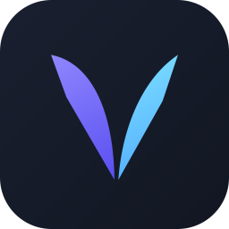

<p align="center"></p>

<h1 align="center">Vela Client</h1>

<p align="center">
Клиент «всё в одном» для Minecraft 26.2 на Fabric: настраиваемый HUD, визуальные эффекты, помощники для PvP, музыкальный плеер с текстом песен, удобства для выживания и собственные оптимизации рендера. Один мод, одно меню настроек.
</p>

<p align="center">
<a href="https://github.com/SqwaTik/VelaClient/releases/latest">Скачать</a> ·
<a href="https://github.com/SqwaTik/VelaLauncher">Vela Launcher</a> ·
<a href="CHANGELOG.md">Что нового</a>
</p>

> **English.** Vela is an all-in-one client mod for Minecraft 26.2 (Fabric): HUD, visuals, PvP helpers, a music HUD with lyrics, quality-of-life tools and its own render optimizations, in one mod with one settings menu. The interface is in English and Russian. Download the jar from [Releases](https://github.com/SqwaTik/VelaClient/releases/latest) and put it in `mods` together with Fabric API.

## Установка

**Через Vela Launcher (проще всего).** [Лаунчер](https://github.com/SqwaTik/VelaLauncher) сам ставит Minecraft 26.2, Fabric, Java 25 и Vela и обновляет их.

**Вручную.**
1. Поставь [Fabric Loader](https://fabricmc.net/use/) 0.19.2 или новее для Minecraft 26.2.
2. Положи в папку `mods` [Fabric API](https://modrinth.com/mod/fabric-api) и `vela-client-<версия>.jar` из [Releases](https://github.com/SqwaTik/VelaClient/releases/latest).
3. Запусти игру. Меню Vela открывается на **Right Shift**, клавишу можно поменять в настройках.

Нужна Java 25. Отдельно ставить In-Game Account Switcher, Bobby и Mod Menu не нужно: они уже встроены в Vela, и копии из папки `mods` нужно убрать.

## Что внутри

### Интерфейс и HUD
- Своё меню модулей: поиск, избранное, сортировка по алфавиту, режим панелей (список слева, настройки справа).
- Редактор HUD с перетаскиванием. Есть панели: координаты, броня, цель, зелья, перезарядки, инвентарь, бинды, список включённых функций, нажатия клавиш, говорящие в голосовом чате и ближайшие игроки.
- Watermark: FPS, скорость, пинг, тики, время, онлайн.
- **Music HUD.** Показывает, что играет на ПК: вкладка браузера (YouTube, Twitch, YouTube Music), Яндекс Музыка, Spotify и другие плееры. Обложка, спектр в такт музыке, текст песни, перемотка кликом. Есть мини-режим «чёлкой» у верхнего края.
- Стеклянный хотбар, свой прицел с индикацией перезарядки, лента подобранных предметов.
- Звуки интерфейса, плавная прокрутка, анимации. Есть режим уменьшенного движения.
- Комбинации клавиш вроде Ctrl+F для любого бинда.

### Визуал
- **Shaders.** Небо, туман, отражения, мокрые поверхности. Можно писать своё небо на GLSL во встроенном редакторе.
- **Death Recap.** Повтор последних секунд перед смертью: свободная камера, свои глаза или глаза убийцы, замедление, таймлайн ударов, тотемов, зелий, брони и пинга. Повторы можно сохранять.
- **Удары и бой:** Hit Color, Hit Bubbles (преломляющая волна), HP Counter (всплывающий урон), TargetESP, KillEffect, Particles, Hit Sound.
- **Мир:** Explosion Wave (волна взрыва бежит по земле и огибает стены), Mace Smash, JumpCircle, World Particles, Ambience (время, погода, небо), Item Physics.
- **Персонаж:** ViewModel, Swing Animation (десяток анимаций взмаха), Motion Blur, ChinaHat, DashTrail, Self Tag, Wasted (смерть в стиле GTA).
- Свои контуры хитбоксов, выделение блока, яркость, соотношение сторон.

### Удобства
- **Storage Index.** Поиск по всем сундукам, бочкам и шалкерам, которые ты открывал, с меткой на нужном.
- **Loot Memory.** Отмечает обысканные сундуки, сломанные спавнеры и открытые хранилища испытаний.
- **Умный чат.** Время сообщений, упоминания твоего ника, кликабельные координаты, личные сообщения во вкладках, скрытие пароля после `/login` и `/reg`.
- **Container Tools:** поиск предметов и быстрый перенос.
- **Shulker Preview** и **Brew Viewer:** содержимое шалкера и ход варки в подсказке, с закреплением.
- **Death:** координаты смерти и авто-возрождение.
- **Остальное:** Auto Reconnect, Freelook, Trajectories, Pinger (порог брони и здоровья), AutoSprint, Hand Swap, Streamer Mode, Tab Ping (точный пинг в Tab).
- **Far.** Сохранённые чанки видны дальше, чем позволяет сервер (встроенный Bobby).
- Аккаунты Microsoft и офлайн-профили в своём менеджере (встроенный In-Game Account Switcher). Друзья и метки в мире. Конфиги можно передать коротким ключом.

### Оптимизация
Собственный набор оптимизаций рендера с отдельным экраном настроек (Настройки → Интерфейс → Оптимизация рендера). Каждую можно выключить по отдельности.
- **HUD и кадр.** HUD обновляется с частотой монитора, меньше ожиданий GPU и переключений буферов, кольцевой буфер вершин.
- **Модели и текст.** Быстрая сборка моделей мобов и игроков (куб целиком, а не вершина за вершиной), буквы пишутся целыми глифами.
- **Дальние объекты.** LOD для далёких предметов, мобов, игроков и частиц. Упрощение дальних чанков: дальше 128 блоков листва сплошная, мелкие растения не строятся.
- **Карты.** Атлас карт: стена из карт рисуется за несколько вызовов.
- **Невидимое.** Отсечение туманом: местность, полностью скрытая туманом, не рисуется.
- **Подстройка.** Панель FPS (F6) и автоматическая настройка под твоё железо.

Vela работает на OpenGL и на Vulkan. С VulkanMod части, рассчитанные только на OpenGL, выключаются сами.

## Совместимость

- **Sodium, Iris, ImmediatelyFast:** Vela распознаёт их и подстраивается.
- **Simple Voice Chat:** панель говорящих игроков.
- **Конфликты:** не ставь вместе с Vela отдельные In-Game Account Switcher, Bobby, Mod Menu и ZakoOpt. Они уже встроены, Fabric не даст запустить игру с двумя копиями.

## Для владельцев серверов

Vela уважает правила серверов.
- **Известные серверы.** На ReallyWorld, FunTime и HolyWorld функции, запрещённые их правилами, отключаются сами, и игрок видит уведомление, какие именно.
- **Любой другой сервер** может отключить функции сам, плагин для этого не нужен. Функции остаются выключенными и скрытыми, пока игрок на сервере, и возвращаются, когда он выходит. Игрок видит уведомление, что именно отключил сервер.

**Как отключить.** Отправь игроку системное сообщение, которое начинается с `velaclient:disable`, а дальше через пробел или запятую перечисли функции:

```
/tellraw @a "velaclient:disable freelook hitboxes"
```

Чтобы это срабатывало у каждого, кто заходит, поставь эту строку в сообщение при входе: MOTD EssentialsX, приветствие CMI, команда при входе из любого плагина. Vela прячет такое сообщение из чата, игроки без Vela увидят его как обычную строку. Удобнее всего отправлять его только им: например, в EssentialsX сообщение при входе показывается одному игроку.

Что можно указать:
- `*` — все функции, дающие преимущество: `click_pearl`, `crystal_optimizer`, `macros`, `interval_commands`, `near`, `auto_tpaccept`, `freelook`, `hitboxes`, `trajectories`, `far`, `gamma`;
- id любого модуля, в том числе чисто визуального (например, `motion_blur`). Список id есть в `src/main/java/dev/sqwat/vela/core/VelaServices.java`.

Vela принимает только сообщения от самого сервера и только если сообщение целиком начинается с `velaclient:disable`. Строка игрока в чате начинается с его ника, поэтому другой игрок не сможет так отключить тебе функции.

**Плагин Vela Rules.** Если удобнее держать список в конфиге, поставь [Vela Rules](server-plugin/README.md) для Paper или Spigot. В его `config.yml` перечислены все функции Vela, отключаемые помечаются `true`, есть право для обхода и команда `/velarules reload`.

**Для авторов плагинов.** Тот же запрос можно отправить без строки в чате, plugin message в канал `velaclient:disable`. Формат: VarInt — количество строк, затем строки (VarInt-длина и UTF-8), до 256 строк по 64 символа. Отправлять после того, как игрок зарегистрировал канал (`PlayerRegisterChannelEvent` в Paper).

## Сборка из исходников

```bash
./gradlew build
```

Нужен JDK 25. Jar появится в `build/libs/`. Проверка с запуском настоящего клиента делается командой `./gradlew verifyClient`. Как устроен проект, как проверять, ставить и выпускать изменения, описано в [docs/HANDOFF.md](docs/HANDOFF.md). Архитектура кода в [docs/ARCHITECTURE.md](docs/ARCHITECTURE.md), порты на другие версии и NeoForge в [docs/PORTING.md](https://github.com/SqwaTik/VelaClient/blob/port/multiversion/docs/PORTING.md) (ветка `port/multiversion`).

## Лицензии

Код Vela распространяется под MIT. Встроенные сторонние части распространяются под своими лицензиями, в том числе LGPL-3.0-or-later. Полный список, авторы звуков и шрифтов и сделанные изменения — в [THIRD_PARTY.md](THIRD_PARTY.md).
